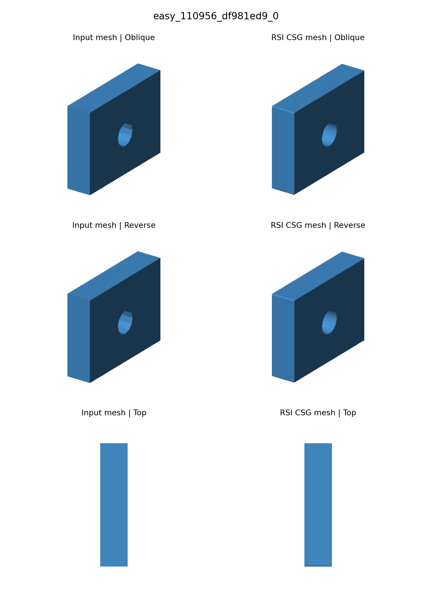
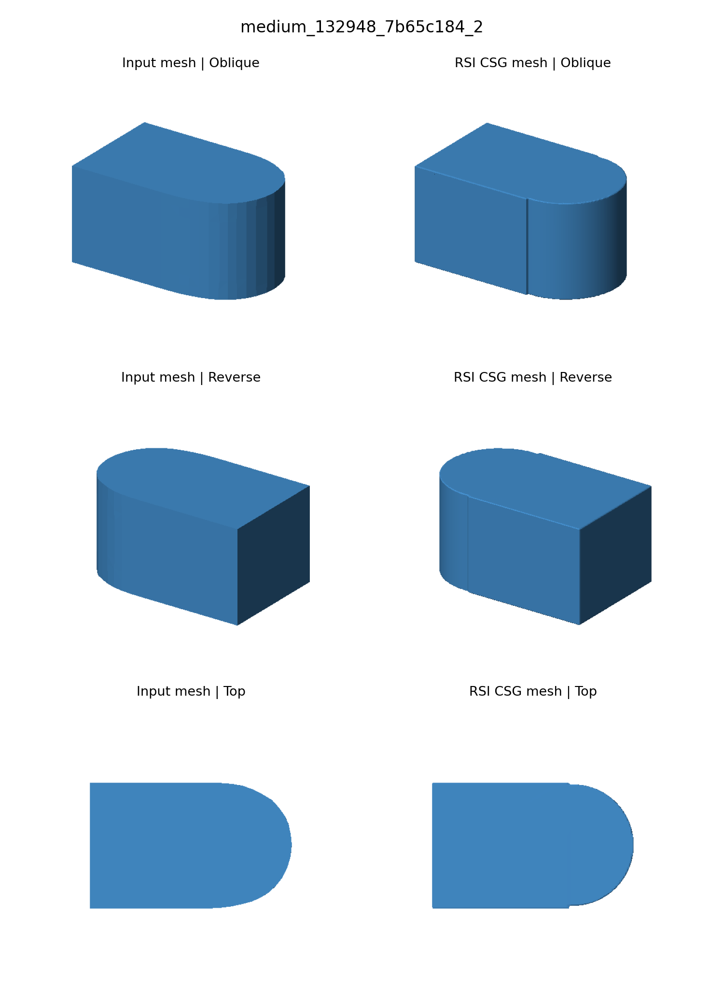
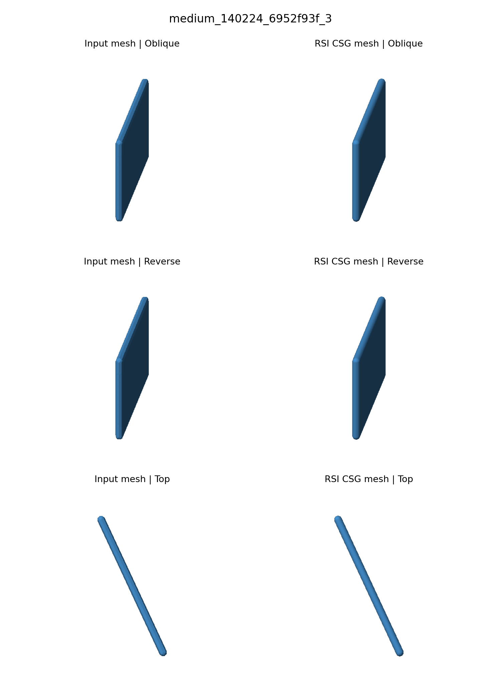
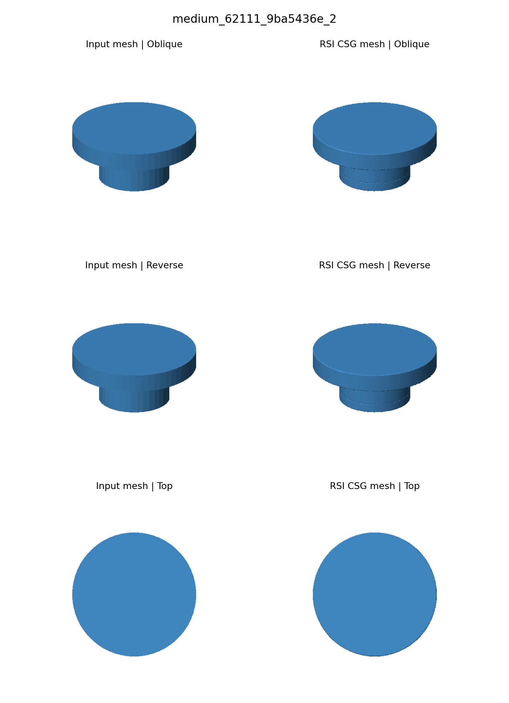
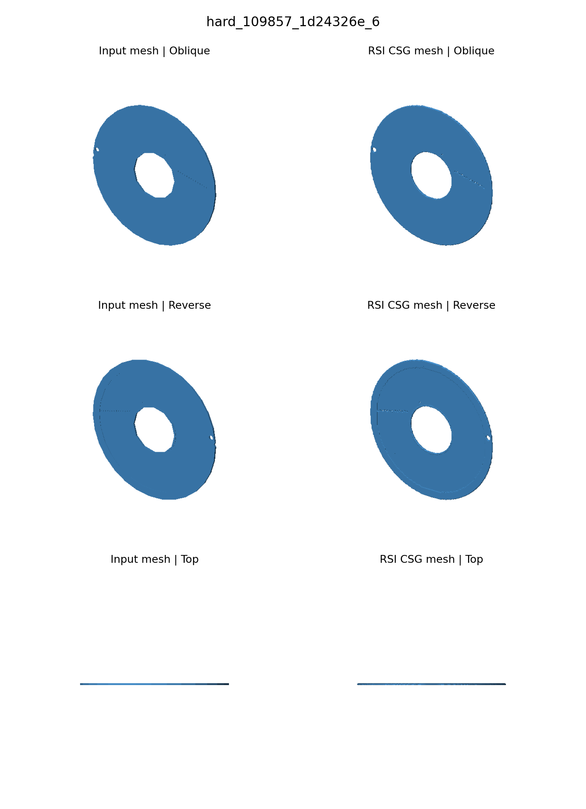
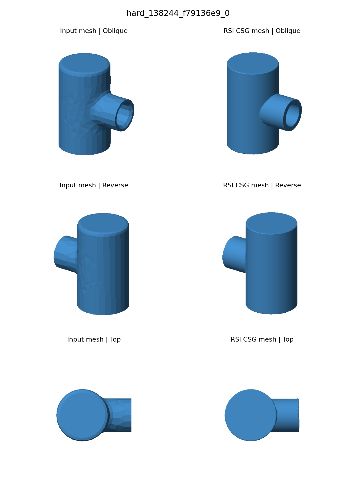
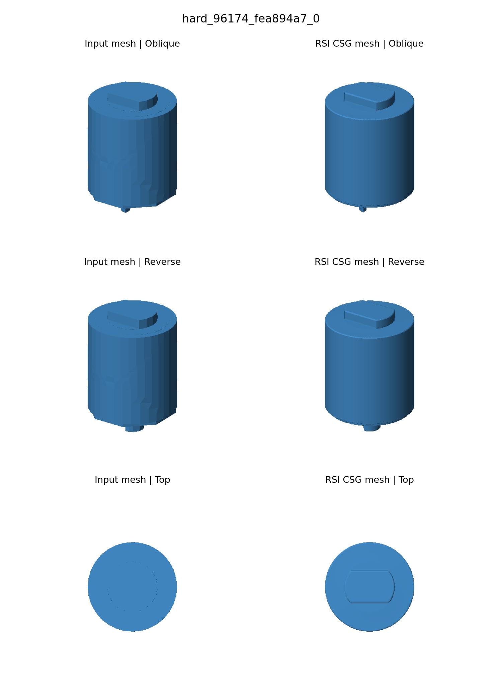

# RSI 九例重建结果与可视化

本报告对应 `standard_9_20261009_trial01`：7 例完整通过，2 例因错误中断。不包含另外运行的 Voron 电机支架。

通过的案例均完成 BRS、DRS、冻结记忆后的新 Actor 重建和最终独立评分。旧三基元结果仅作历史参考；表示、预算和误差口径不同，不能将差值直接归因于 RSI。

## 指标汇总

表面 P95 为对称采样点到三角面的距离，以下以输入包围盒对角线的百分比表示。

| 案例 | 状态 | IoU 48³ | IoU 96³ | 表面 P95 / 对角线 | 基元数 | 耗时（分钟） |
|---|---|---:|---:|---:|---:|---:|
| easy_110956_df981ed9_0 | PASS | 1.0000 | 0.9992 | 0.072% | 2 | 19.3 |
| easy_129012_576921da_0 | 错误中断 | — | — | — | — | 0.9 |
| easy_23853_4f653200_4 | 错误中断 | — | — | — | — | 18.2 |
| medium_132948_7b65c184_2 | PASS | 0.9967 | 0.9892 | 0.231% | 2 | 26.2 |
| medium_140224_6952f93f_3 | PASS | 0.9796 | 0.9882 | 0.139% | 9 | 32.5 |
| medium_62111_9ba5436e_2 | PASS | 1.0000 | 0.9930 | 0.071% | 4 | 26.7 |
| hard_109857_1d24326e_6 | PASS | 0.9839 | 0.9839 | 0.058% | 22 | 29.0 |
| hard_138244_f79136e9_0 | PASS | 0.9584 | 0.9546 | 0.379% | 4 | 42.6 |
| hard_96174_fea894a7_0 | PASS | 0.9909 | 0.9932 | 0.182% | 9 | 29.9 |

## 逐例可视化

每组左侧为输入三角网格，右侧为最终 STL 三角网格；依次展示斜视、反向斜视和俯视。使用完整三角面进行正交射线渲染，保留遮挡关系，不使用点云或网格简化。两侧视角、尺度和光照一致；蓝色明暗表示表面法向光照，不表示重建误差。内部封闭结构未通过剖面展示。

### easy_110956_df981ed9_0

最终 IoU（96³）：**0.9992**；基元数：**2**；独立验证：**PASS**。

[CSG 程序](cases/easy_110956_df981ed9_0/final/program.json) · [重建 STL](cases/easy_110956_df981ed9_0/final/reconstruction.stl) · [完整指标](cases/easy_110956_df981ed9_0/final/metrics.json)

### easy_129012_576921da_0

BRS 阶段网格导出不闭合（`Export is not watertight`），未生成最终重建图和评分。

[错误详情](cases/easy_129012_576921da_0/error.txt) · [运行结果](cases/easy_129012_576921da_0/result.json)

### easy_23853_4f653200_4

BRS 和 DRS 已完成，DRS 目标验证通过；冻结记忆后的最终重建阶段模型服务返回 HTTP 502/503，未生成最终重建图和评分。DRS 通过不能代替最终评分。

[错误详情](cases/easy_23853_4f653200_4/error.txt) · [运行结果](cases/easy_23853_4f653200_4/result.json)

### medium_132948_7b65c184_2

最终 IoU（96³）：**0.9892**；基元数：**2**；独立验证：**PASS**。

[CSG 程序](cases/medium_132948_7b65c184_2/final/program.json) · [重建 STL](cases/medium_132948_7b65c184_2/final/reconstruction.stl) · [完整指标](cases/medium_132948_7b65c184_2/final/metrics.json)

### medium_140224_6952f93f_3

最终 IoU（96³）：**0.9882**；基元数：**9**；独立验证：**PASS**。

[CSG 程序](cases/medium_140224_6952f93f_3/final/program.json) · [重建 STL](cases/medium_140224_6952f93f_3/final/reconstruction.stl) · [完整指标](cases/medium_140224_6952f93f_3/final/metrics.json)

### medium_62111_9ba5436e_2

最终 IoU（96³）：**0.9930**；基元数：**4**；独立验证：**PASS**。

[CSG 程序](cases/medium_62111_9ba5436e_2/final/program.json) · [重建 STL](cases/medium_62111_9ba5436e_2/final/reconstruction.stl) · [完整指标](cases/medium_62111_9ba5436e_2/final/metrics.json)

### hard_109857_1d24326e_6

最终 IoU（96³）：**0.9839**；基元数：**22**；独立验证：**PASS**。

[CSG 程序](cases/hard_109857_1d24326e_6/final/program.json) · [重建 STL](cases/hard_109857_1d24326e_6/final/reconstruction.stl) · [完整指标](cases/hard_109857_1d24326e_6/final/metrics.json)

### hard_138244_f79136e9_0

最终 IoU（96³）：**0.9546**；基元数：**4**；独立验证：**PASS**。

[CSG 程序](cases/hard_138244_f79136e9_0/final/program.json) · [重建 STL](cases/hard_138244_f79136e9_0/final/reconstruction.stl) · [完整指标](cases/hard_138244_f79136e9_0/final/metrics.json)

### hard_96174_fea894a7_0

最终 IoU（96³）：**0.9932**；基元数：**9**；独立验证：**PASS**。

[CSG 程序](cases/hard_96174_fea894a7_0/final/program.json) · [重建 STL](cases/hard_96174_fea894a7_0/final/reconstruction.stl) · [完整指标](cases/hard_96174_fea894a7_0/final/metrics.json)

## 运行记录

已记录模型调用：1206；返回记录中的总 token：11,756,251。

[运行日志](runtime.log) · [配置及版本记录](manifest.json) · [批次状态](batch_status.json) · [HTML 对比页](visualization.html)

各案例目录保留 `events.jsonl`、角色对话、验证证据和记忆快照。失败案例保留在统计中，没有用中间结果替代最终评分。
