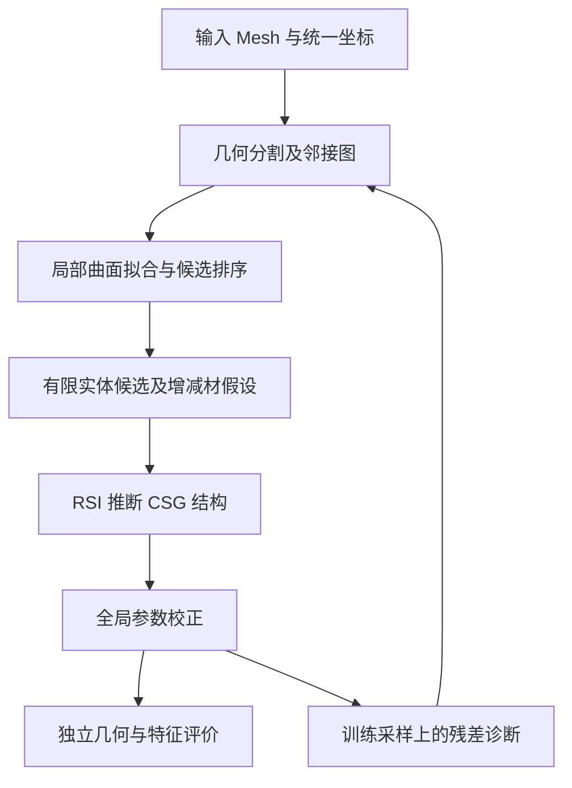

# 面向局部细节保持的三维分割与局部基元拟合 CSG 重建方案

日期：2026-10-16｜状态：研究提案，方法与效果尚待实验验证

## 1. 研究动机与目标

本研究的出发点是：**直接对完整模型进行整体拟合，结构搜索难度高，局部细节难以控制；先将三维几何分解为较简单的区域，再进行局部基元拟合，可能降低求解难度并改善细节保持。** 最终目标是恢复可执行、可编辑的 CSG 程序及闭合实体，而不止输出分割标签或独立曲面。

整体重建同时涉及基元类型、数量、位姿、尺寸和布尔树结构。以带通孔、窄槽和薄壁的支架为例，主体轮廓拟合正确，并不意味着孔径、槽深和壁厚也正确。按面积或体积聚合的指标可能弱化小特征的影响；而一次全局参数调整还可能改善主体、损害细节。上述机制是本方案的研究动机，不作为已经验证的失败原因。

当前项目已有 Mesh → RSI → CSG 流程，支持六类实体基元和并、差、交运算，数值优化负责调整给定树结构的参数。[项目说明](experiments/mesh_to_implicit_primitives/RSI_README.md)及[九例报告](experiments/mesh_to_implicit_primitives/results/rsi_standard_9_20261009/报告.md)提供实现与历史结果，但尚无同预算的分割消融实验。因此，不能将已有整体指标直接解释为本方案的有效性证据。

**研究问题：在基元表示和总计算预算相同的条件下，先三维分割、再局部拟合与全局组装，能否比直接整体拟合更准确地恢复局部特征，同时保持整体几何质量和实体有效性？**

拟检验三个假设：局部候选可减少结构与参数搜索的耦合；分区域监督与资源分配可提高小特征恢复率；分割调整和全局校正可缓解局部独立拟合造成的不一致。即使效果未提升，也应能区分瓶颈来自分割、表示还是组装。

## 2. 相关工作与研究定位

| 工作 | 与本方案相关的思路 | 本方案仍需解决的问题 |
|---|---|---|
| SPFN [1] | 预测点归属、法向和类型，再通过可微求解器估计曲面参数 | 曲面候选到有限实体及布尔树的转换 |
| ParSeNet [2] | 点云分解与参数曲面拟合，包含解析曲面和样条曲面 | 曲面集合如何形成有效的 CSG 实体 |
| Point2Cyl [3] | 利用几何属性与分割恢复拉伸体 | 不同实体表示下的候选生成和组装歧义 |
| InverseCSG [4] | 结合几何处理与程序合成恢复 CSG 树 | 分割是否能在我们的预算与数据下改善细节 |
| CAPRI-Net [5] | 学习基于二次曲面基元组装的隐式 CAD 表示 | 与显式局部分解路线的表示和优化差异 |

SPFN 的基元残差损失对不同基元等权平均，为避免大表面主导优化提供参考；但其数据预处理剔除了面积占比低于 2% 的微小基元，不能据此推断对任意微小细节均有效。[1，§3.3、§4.1] 本方案不照搬其 PointNet++ 架构，也不以复现 SPFN 为前提。

“先分割再拟合”已有先例。拟研究的重点是：**面向最终实体重建的区域划分、局部候选到增减材操作的转换，以及通过重建误差反向修正分割。** 这些属于待验证的贡献方向，尚不构成已确认的新颖性结论。

## 3. 方法设计

### 3.1 总体流程与表示边界

输入为非空、闭合且面朝向一致的机械零件 Mesh；缺面扫描暂不进入核心实验。输出为兼容当前格式的 CSG 程序、导出 Mesh 和分阶段诊断信息。分割对象是几何曲面区域，不预设语义部件，也不假设一个区域恰好对应一个实体基元。

最终独立评价不参与反馈。反馈只使用优化阶段允许访问的输入几何与采样，防止反复使用最终测试点选择模型。

### 3.2 几何分割：产生适合拟合的区域

#### 3.2.1 传统三维分割备选方法

本方案优先考虑无需训练的几何方法。需区分曲面分割、部件分割与基元检测：光滑区域未必对应单一解析曲面，部件可能包含多个基元，而基元检测往往同时完成分割与参数估计。下表的方法机制来自官方文档，适用性与局限分析是面向本项目的设计判断，尚未通过同条件实验排名。

| 备选方法 | 输入与机制 | 在本方案中的用途 | 局限与注意事项 |
|---|---|---|---|
| 法向／曲率区域生长 [6] | 点云及邻域；根据法向相似性接纳邻点，以曲率等条件控制继续扩张 | 无需训练的曲面分割基线 | 对邻域尺度和阈值敏感；相切过渡可能连成一个区域，不能保证单一区域可由单一基元解释 |
| 模型约束区域生长 [7] | 点集或 Mesh 邻接图；以当前拟合模型的残差约束生长 | 在分割阶段引入可拟合性，减少混合曲面区域 | 依赖模型类型、种子与生长顺序；CGAL 的具体支持类型需按实现核对，不能假定与其 RANSAC 类型完全相同 |
| Efficient RANSAC [7] | 带法向点云；随机提出模型，按距离、法向一致性和连通性提取支持点 | 联合基元检测与分割基线，也可用于区域内鲁棒初始化 | 小形状可能漏检，最小支持点数可能排除小特征；输出曲面及点集，不直接给出 CSG 布尔角色 |
| Mesh 锐边＋连通区域分割 [8] | 三角网格；依据相邻面的二面角标记锐边，再划分面邻接图 | 优先利用现有 Mesh 拓扑，产生初始曲面片 | 平滑圆角处可能没有锐边；粗三角化也可能产生不希望的分割，需要后续拟合反馈 |
| 超体素＋邻接图合并 [9] | 点云先划为小块，再依据法向、空间关系或拟合代价合并 | 面向较大点云降低后续图处理规模 | 超体素是中间表示；初始尺度过大时可能吞掉孔口或薄壁细节 |
| 局部凹凸性分割 LCCP [10] | 在超体素图上合并局部凸连接区域、沿凹边界划分 | 可作为部件级粗分解或辅助边界线索 | 部件边界不等于解析曲面边界，仍需进一步曲面分割；不能单凭凹凸性判定 CSG 差集 |
| 局部厚度＋图割 [11] | Mesh；计算 Shape Diameter Function，再进行图割分区 | 辅助区分厚主体与细长部件 | 厚度分区未必与基元边界对齐；这里的 SDF 是形状直径函数，不是有符号距离函数 |

CGAL 的 Efficient RANSAC 提供平面、球面、圆柱面、圆锥面和圆环面检测。[7] 将其作为备选前端时，需统一后续实体库和候选预算，避免把类型覆盖差异误判为分割质量差异。

纯点云输入可用局部 PCA 估计法向：计算邻域协方差矩阵，取最小特征值对应的特征向量。常用表面变化量为 $c=\lambda_{\min}/(\lambda_1+\lambda_2+\lambda_3)$；它是局部几何描述量，不等于精确主曲率。[12] 建议在开发集比较多种邻域尺度：小邻域容易受噪声影响，大邻域可能混合边界两侧。法向定向另行处理；仅有无向法向不能确定实体内外。

#### 3.2.2 首版选择与迭代策略

首版选择 **Mesh 面邻接与锐边约束 → 保守区域生长 → 局部多类型拟合 → 残差驱动拆分／合并**。已有 Mesh 时保留拓扑进行分割，再在区域内部采样拟合；不先丢弃拓扑转为纯点云。这样可以降低薄壁两侧因空间接近而被近邻图误连的风险，但仍需检查网格质量。

Efficient RANSAC 作为独立对照前端；纯法向区域生长用于检验增加模型残差约束是否必要。超体素、LCCP 和厚度分割作为规模扩展或粗分解备选，不要求首版同时实现。这里的“先分割再拟合”允许迭代：拟合残差是修正区域划分的依据，而非将初始分割永久固定。

统一归一化后，在原 Mesh 上建立面邻接图，结合二面角、法向变化和曲率进行区域生长。锐边用于限制跨边界扩张，曲率与连通性用于辅助识别圆柱壁、过渡区和薄结构。均匀采样用于覆盖整体，边界及小区域加密用于保留细节；采样策略也必须在对照组中单独控制。

初始分割采用偏细的区域划分，再根据同类曲面拟合残差与邻接关系合并。不能仅因面积小就删除区域。高残差区域允许继续拆分；少量点不足以稳定拟合时保留为未解释区域，不能强制归入最近的大平面。第一阶段采用几何方法，以便定位问题；学习式分割是后续可替换模块。

每个区域保留邻域上下文和边界点，但明确核心点与共享上下文的不同权重，避免重复计权。分割质量最终由重建效果检验，标签整齐或分割 IoU 高并不自动意味着适合 CSG 重建。

### 3.3 局部基元拟合：先获得可靠几何候选

首版局部曲面候选包括平面、圆柱面、球面与圆锥面。通过加权最小二乘或鲁棒估计初始化，再用几何距离和法向一致性细化。每区保留少量不同类型候选，按拟合误差、参数稳定性和复杂度排序，不在早期强制唯一分类。

局部目标写为：

$$
E_r(\theta,t)=\frac{1}{\sum_i w_i}\sum_{i\in P_r}w_i\rho\!\left(\frac{d(p_i,S_{t,\theta})}{D}\right)
+\lambda_n E_{\mathrm{normal}}+\lambda_c C(t,\theta).
$$

其中，$P_r$ 为区域点集，$S_{t,\theta}$ 为候选曲面，$D$ 为输入包围盒对角线，$\rho$ 为鲁棒惩罚，$C$ 为复杂度或退化惩罚。权重和阈值只在开发集选择。对近共线点、过小圆弧等病态拟合，输出不稳定标记并保留替代候选。

多个平面片可以共同约束一个盒体；同轴圆柱片可以归并为同一曲面证据。未被四类曲面解释的区域保留到实体候选阶段，可由现有圆环、胶囊候选或局部多基元组合处理。若仍不能满足容差，应记录表示失败，不靠无限增加基元掩盖问题。

### 3.4 从曲面到实体，再到 CSG

这是完整方案的关键：曲面拟合没有确定实体的边界、内部方向或布尔角色。圆柱面可以来自孔壁，也可以来自凸台；轴向观测范围也不一定等于真实实体长度。

因此，结合邻接平面、边界环、投影范围以及原 Mesh 的内部／外部查询，提出有限长度和封口位置的多个假设。平面作为实体边界证据，不能直接作为当前 CSG 格式的叶节点。实体库保持现有盒体、有限圆柱、球、圆台、圆环与胶囊；不额外引入样条或拉伸体改善核心对照。

RSI 接收候选实体、支撑区域、局部误差和邻接关系，提出并集、差集或交集组合。用整体占据约束过滤明显错误的组合，以局部特征误差区分“主体相似但孔槽错误”的候选。允许删除冗余叶节点或提出残差驱动的新候选，所有尝试计入预算。

例如，带通孔的板件应由板体与减法圆柱解释：圆柱半径由孔壁拟合，长度由贯通假设与实体内外证据确定，随后检验孔口和内部连通性。仅把孔壁拟合成圆柱面不能视为重建完成。

### 3.5 全局联合校正与反馈

在固定树结构下优化所有基元参数，以分区域误差、整体占据和关系约束共同评价：

$$
E=\lambda_g E_{\mathrm{global}}+
\lambda_l\frac{1}{R}\sum_{r=1}^{R}E_r^{\mathrm{surface}}
+\lambda_b E_{\mathrm{boundary}}+\lambda_q E_{\mathrm{relation}}+\lambda_k|T|.
$$

$E_{\mathrm{global}}$ 包含整体占据约束和双向表面误差；$E_r^{\mathrm{surface}}$ 比较区域与最终 CSG 暴露表面，避免只拟合已被布尔运算隐藏的叶节点；其余项约束边界、共面／同轴关系及树复杂度。几何距离按 $D$ 归一化，关系约束只在有足够证据时启用。

区域等权可能放大过分割噪声，因此须与区域合并及置信度处理联合验证。CSG 组合场不一定是真实欧氏 SDF，最终表面误差使用点到三角面距离，不直接用场值绝对值代替。残差反馈在预设轮数和预算内终止；候选退化时保留此前较优的有效实体。

### 3.6 与当前工程的接口

分割模块输出区域标识、支撑面／点、边界及邻接关系；拟合模块输出曲面类型、参数、残差和稳定性；实体化模块输出实体候选及来源区域；RSI 负责树结构选择，数值工具负责参数校正。

最终维持 `program.json` 的 `schema_version=1`、二叉布尔树和现有基元参数约定，辅助诊断独立保存。坐标使用现有统一归一化；若局部拟合采用局部坐标，组装前必须还原。现有数值优化器只提供接入基础，上述损失、候选接口和反馈逻辑均属于拟新增功能。

## 4. 实验设计与成功判据

### 4.1 数据与公平比较

现有九例用于探索和失败诊断，不能作为从未见过的泛化测试集。另构建板件、支架、带槽块体三类合成模型，系统改变孔径、槽宽、壁厚和特征面积占比，特别覆盖低于 2% 的细节。按结构模板划分开发与测试集，避免同一形状的近重复参数实例跨集合。

生成程序、特征真值和测试标注仅由评价端持有。人工分区辅助实验单列为诊断条件，不计入自动方法成绩。最终需要补充未参与调参的真实 CAD 网格验证外部适用性。

| 组别 | 设置 | 检验目的 |
|---|---|---|
| A | 当前全局 RSI/CSG 拟合 | 基线 |
| B | 全局拟合＋局部重采样／加权，不使用局部参数候选 | 排除仅由采样和权重造成的收益 |
| C | 人工分区＋局部拟合＋组装校正 | 判断分解思路在较理想分区下是否有效 |
| D | 自动分割＋局部拟合＋组装，关闭全局联合校正与反馈 | 测量局部求解及组装的直接效果 |
| E | 完整方案，开启联合校正与分割反馈 | 衡量完整流程 |

进一步分别关闭 E 的区域等权、联合校正和分割反馈，避免把多个机制的收益混为一谈。B 使用与 E 相同的初始区域辅助加权，但不进行局部候选拟合；C 只反映人工辅助条件。

分割前端另设受控比较：首版 Mesh 分割、纯法向区域生长、Efficient RANSAC 分别接入相同的候选筛选、实体化与 CSG 后端。RANSAC 自带的参数估计计入前端成本，各组统一支持的候选类型、候选上限及后续细化过程；明确该实验比较的是“分割／检测前端”，不能将收益全部归因于标签划分。记录小区域漏检、过分割和最终特征恢复情况；超体素、LCCP 与厚度分割仅在进入后续研究时增加对照。

各组使用相同实体库、输入采样总量和硬件；默认总叶节点上限 24、深度上限 12。采用相同 RSI 学习安排与冻结记忆，单独比较最终重建阶段，统一 30 分钟预算，包含分割、候选生成、结构尝试与数值优化。报告调用量、token 和预处理时间。使用 42、43、44 三个配对随机种子；方法专属训练或学习的成本另列。

### 4.2 指标与判定

全局报告 96³ IoU、双向表面距离及闭合性；局部报告预先标定区域的距离、孔径／槽宽／壁厚误差、孔槽恢复率和贯通性。局部评价区域来自输入标注或生成真值，不能由预测分割决定。保留基元数、树深度、耗时和无有效结果的失败比例。

薄结构小于体素尺度时，补充局部加密、截面测量和连通性检查。区域尾部误差和最大误差用于发现被整体 P95 掩盖的细节。先展示逐例、逐特征尺度的配对结果，再汇总中位数与离散程度，不用九例均值支持广泛泛化结论。

建议预先冻结以下工程继续判据，数值是拟定目标而非实验结果：在独立合成测试集上，E 相对 A 的主要局部表面误差中位数至少下降 10%，整体 IoU 中位数下降不超过 0.01，闭合有效率和特征恢复率不降低；同时需优于 B 才能支持局部候选的额外价值。若 C 有效而 E 无效，优先研究分割；若 C 也无效，则重新检查表示和实体组装。无有效实体的案例不能从汇总中删除。

## 5. 风险、阶段与预期产出

过分割可能增加候选与布尔搜索规模，欠分割可能把不同曲面强行拟合为一个基元；通过残差驱动拆分／合并和预算约束检查两者。边界噪声可能引起参数漂移，邻接关系也可能错误，不能将所有几何关系强制锁定。孔槽歧义通过多假设与全局占据验证处理，但几何上等价的 CSG 程序仍可能有多个，因此不宣称恢复原始建模历史。

按三个阶段推进：第一阶段完成区域可视化、局部拟合和 A/B/C 诊断；第二阶段实现有限实体候选与 CSG 组装，验证闭合性和增减材判断；第三阶段实现联合校正及反馈，完成自动方案和消融。每阶段保存失败案例、耗时及中间候选，出现负结果时根据前述判据调整路线。

预期产出是可复现的分割引导 CSG 原型、针对细节的评价协议，以及对“何时分解有帮助、何时瓶颈仍在表示或组装”的实证分析。当前交付仅为 proposal；未执行上述实验，未确认性能提升或论文新颖性。

## 参考文献与证据说明

1. Li, L., Sung, M., Dubrovina, A., Yi, L., & Guibas, L. J. **Supervised Fitting of Geometric Primitives to 3D Point Clouds.** CVPR, 2019. [原文](https://arxiv.org/abs/1811.08988)；[本地 PDF](papers/spfn_1811.08988/SPFN_1811.08988.pdf)。本地 v4 已阅读正文和补充材料，11 页结构检查通过；此检查不等于研究结论验证。
2. Sharma, G., et al. **ParSeNet: A Parametric Surface Fitting Network for 3D Point Clouds.** ECCV, 2020. [原文与摘要](https://arxiv.org/abs/2003.12181)。
3. Uy, M. A., et al. **Point2Cyl: Reverse Engineering 3D Objects from Point Clouds to Extrusion Cylinders.** CVPR, 2022. [原文与摘要](https://arxiv.org/abs/2112.09329)。
4. Du, T., et al. **InverseCSG: Automatic Conversion of 3D Models to CSG Trees.** ACM Transactions on Graphics, 37(6), 2018. [作者项目页](https://inversecsg.csail.mit.edu/)；[DOI](https://doi.org/10.1145/3272127.3275006)。
5. Yu, F., et al. **CAPRI-Net: Learning Compact CAD Shapes with Adaptive Primitive Assembly.** [作者预印本](https://arxiv.org/abs/2104.05652)。
6. Point Cloud Library. **Region Growing Segmentation.** [官方教程](https://pointclouds.org/documentation/tutorials/region_growing_segmentation.html)。
7. CGAL. **Shape Detection: User Manual.** Efficient RANSAC 与模型约束区域生长。[官方文档](https://doc.cgal.org/latest/Shape_detection/index.html)。
8. CGAL. **Polygon Mesh Processing: Feature Detection Functions.** 锐边检测与面片分割。[官方文档](https://doc.cgal.org/latest/Polygon_mesh_processing/group__PMP__detect__features__grp.html)。
9. Point Cloud Library. **SupervoxelClustering.** [官方接口文档](https://pointclouds.org/documentation/classpcl_1_1_supervoxel_clustering.html)。
10. Point Cloud Library. **LCCPSegmentation.** [官方接口文档](https://pointclouds.org/documentation/classpcl_1_1_l_c_c_p_segmentation.html)。
11. CGAL. **Triangulated Surface Mesh Segmentation.** Shape Diameter Function 与图割分割。[官方文档](https://doc.cgal.org/latest/Surface_mesh_segmentation/group__PkgSurfaceMeshSegmentationRef.html)。
12. Point Cloud Library. **Estimating Surface Normals in a PointCloud.** [官方教程](https://pointclouds.org/documentation/tutorials/normal_estimation.html)。

资料核对日期：2026-10-16。除 SPFN 外，研究论文仅引用已核验的摘要或作者项目页所支持的方法定位；传统方法的机制与接口依据上述官方文档，不表示已在本项目中完成复现或效果验证。本文由 AI 辅助整理与起草；文献事实、项目现状与拟议方法已区分，实验阈值为研究设计提议。
